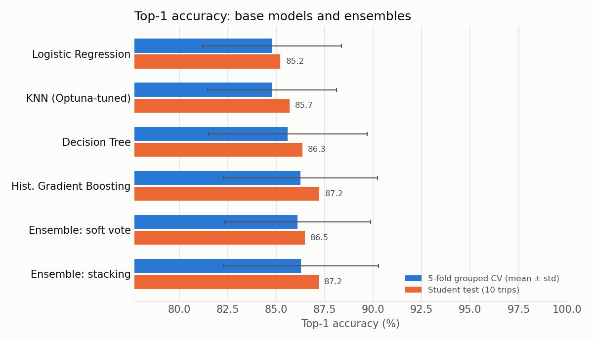
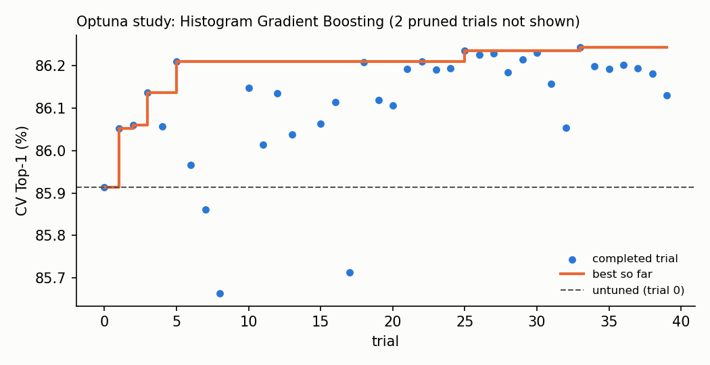
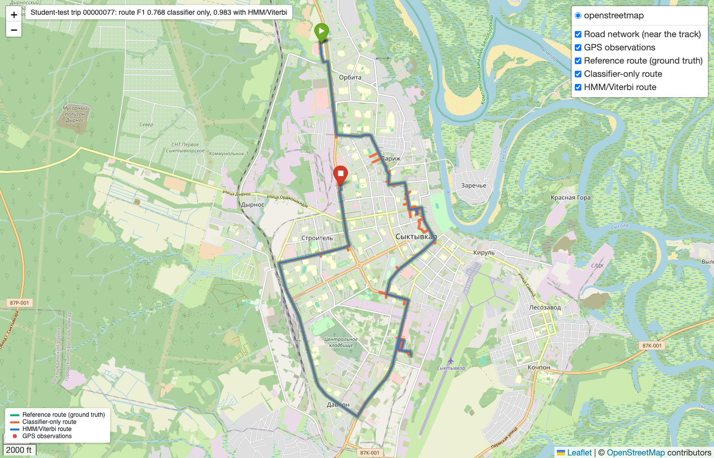
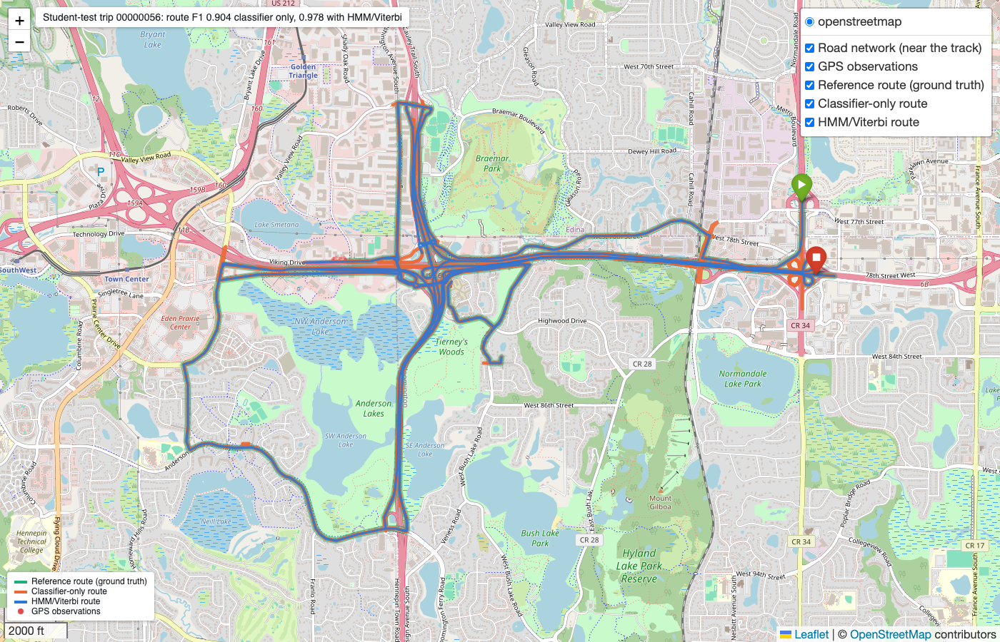
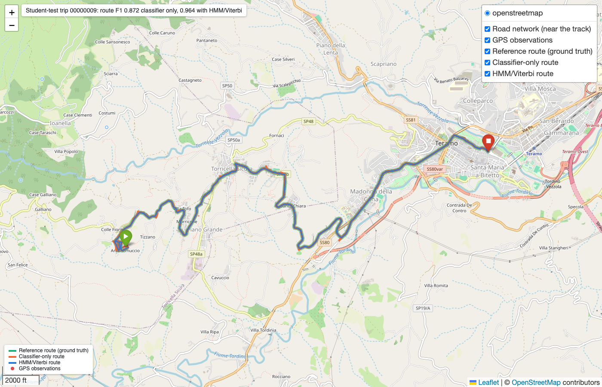

# PathSnap: map-matching and route reconstruction

**Course:** UE24CS352A, PES University. **Repository:** this repository; every number below is produced by a script under `scripts/` and stored under `results/`.

## 1. Problem

A vehicle's GPS track is a sequence of noisy points. PathSnap infers which directed road arc of the supplied network the vehicle was on at each point, then reconstructs the connected sequence of arcs it drove. GPS noise, multipath near buildings, sampling gaps and parallel or two-way roads make the nearest road wrong in about 45 % of readings, so the system combines a learned candidate scorer with a hidden Markov model (HMM) decoded by Viterbi.

## 2. Data

Each trip folder has four headerless, whitespace-separated files. Node and arc IDs are zero-based row indices and are preserved.

| File | Columns | Use |
| --- | --- | --- |
| `.track` | longitude, latitude, elapsed seconds | prediction input |
| `.nodes` | longitude, latitude | prediction input |
| `.arcs` | from-node, to-node (directed) | prediction input |
| `.route` | ordered arc IDs | labels and evaluation only |

| Partition | Trips | Use |
| --- | ---: | --- |
| Training | 80 | fitting, 5-fold cross-validation grouped by trip, all tuning |
| Student test | 10 | one final comparison per model |
| Evaluator test | 10 | never read during development |

The training partition has 208,417 GPS readings, 1.93 million nodes and 3.88 million arcs, with no missing files, malformed rows or invalid references (`docs/DATASET_EXPLORATION_FINDINGS.md`). Sampling is normally 1 Hz, but 590 gaps exceed 10 s and the longest is 153,064 s. Road networks have between 1 and 421 weakly connected components and contain parallel directed arcs, so connectivity is checked explicitly and arc identity is kept.

## 3. Candidates, labels and features

Implementation: `src/pathsnap/features/candidate_features.py`.

- **Projection.** Each trip is projected to a local equirectangular plane in metres, centred on the track. Trips span under about 80 km, where the distance error stays well below 1 %.
- **Candidates.** Every arc within 50 m of a reading, nearest 10 kept, found with a KD-tree over points spaced 10 m along each arc. Both directions of a two-way road are separate candidates. The candidate miss rate (labelled readings whose true arc is not among the candidates) is 0.13 % on student test.
- **Labels.** The `.route` file lists arcs in order but does not say which reading belongs to which arc. A monotone dynamic programme aligns readings to route arcs, minimising point-to-arc distance while both indices only move forward. Readings whose aligned arc is more than 50 m away are unlabelled and excluded from training and scoring. These are derived labels, not independently surveyed ground truth.
- **Features (15)**, all computed from the track and the map only:

| Group | Features |
| --- | --- |
| Distance | `dist`, `dist_rank`, `dist_minus_min`, `win_dist` (mean distance of readings i-3..i+3 to the arc) |
| Heading | `cos_heading` (vehicle heading vs arc direction), `heading_ok` (vehicle moved more than 2 m) |
| Motion | `speed`, `dt_prev` |
| Arc and network | `arc_len`, `proj_t` (position along the arc), `n_cand`, `junction_deg`, `has_reverse` |
| Continuity | `cont_prev`, `cont_next` (does the arc touch the nearest arc of the neighbouring readings) |

## 4. Evaluation protocol

- **Cross-validation:** 5-fold `GroupKFold` with trips as groups, so no trip is split between training and validation. Validation scores every 3rd reading with all of its candidates.
- **Student test:** every model is refit on all 80 training trips and scored once on the 10 student-test trips. No decision used student-test numbers.
- **Metrics:** row-level accuracy, precision, recall, macro F1, log loss and confusion matrix (threshold 0.5); reading-level Top-1 accuracy (the highest-scored candidate is the aligned arc; readings without candidates count as wrong); candidate miss rate; and route-level precision, recall, F1 and Newson–Krumm mismatch fraction, all length-weighted in metres, plus route continuity (share of consecutive route arcs that touch).

## 5. Candidate models

Four independently configured model families score candidates. All of them read the same 15 features and use the same folds, so their numbers are directly comparable. Full details are in `docs/report/ensemble.md`, `docs/report/knn.md` and `docs/report/hgb_tuning.md`.

| Model | Family | Configuration | Training rows |
| --- | --- | --- | --- |
| Logistic Regression | Linear | StandardScaler, balanced class weights | every reading |
| KNN | Instance-based | Optuna-tuned: k = 31, distance weights, feature-group multipliers | every 5th reading |
| Decision Tree | Tree | depth 12, at least 30 rows per leaf | every reading |
| Histogram Gradient Boosting | Boosted trees | Optuna-tuned: 250 iterations, learning rate 0.018, 106 leaves, depth 14 | every reading |

Two ensembles combine them:

- **Soft vote:** an equal-weight average of the four probabilities.
- **Stacking:** a logistic regression trained on out-of-fold base probabilities.

### Results before sequence decoding

| Model | CV Top-1 | Test Top-1 | Test macro F1 | Test log loss | Fit | Test scoring |
| --- | --- | ---: | ---: | ---: | ---: | ---: |
| Logistic Regression | 84.77 ± 3.58 % | 85.21 % | 0.826 | 0.235 | 3 s | 0.06 s |
| KNN (Optuna-tuned) | 84.78 ± 3.32 % | 85.67 % | 0.912 | 0.131 | 0.5 s | 51 s |
| Decision Tree | 85.59 ± 4.09 % | 86.34 % | 0.917 | 0.103 | 24 s | 0.03 s |
| Hist. Gradient Boosting (tuned) | 86.24 ± 3.97 % | **87.21 %** | **0.922** | 0.093 | 26 s | 0.7 s |
| Ensemble: soft vote | 86.10 ± 3.77 % | 86.46 % | 0.920 | 0.115 | 54 s | 52 s |
| **Ensemble: stacking** | **86.27 ± 4.00 %** | 87.18 % | **0.922** | **0.092** | 54 s | 52 s |

For reference, always choosing the nearest candidate is right for only 54.5 % of labelled student-test readings (55.6 % on training).



### Over- and underfitting

- **Cross-validation and test agree.** Test Top-1 is 0.4 to 1.0 points above the cross-validation mean for every model, inside one fold standard deviation. The student-test trips are slightly easier than the hardest training folds, and no model shows a train-to-test collapse.
- **KNN at k = 1 overfits.** Its validation log loss is 0.92 because the hard 0/1 votes make mistakes confidently wrong. k = 31 is the tuned compromise. See the sweep in `docs/report/knn.md`.
- **The decision tree is constrained** to depth 12 with at least 30 rows per leaf. The tuned booster uses strong regularisation: 159 rows per leaf, feature subsampling and a low learning rate.
- **Fold spread comes from trip difficulty.** Fold 3 is the hardest for every model, at about 78 % Top-1, which points to the trips rather than to model variance.

## 6. Bayesian hyperparameter optimisation

Optuna's TPE sampler (seed 42) was used for both tuned models. The objective was always measured on 5-fold trip-grouped cross-validation of the training trips. The untuned configuration was enqueued as trial 0, so tuned and untuned results come from the identical protocol. Student-test and evaluator trips were never used during any search.

| Study | Trials | Objective | Untuned → tuned (CV) | Untuned → tuned (student test) | Cost |
| --- | ---: | --- | --- | --- | ---: |
| KNN | 40 (18 pruned) | macro F1 | 0.901 → 0.905 | Top-1 85.3 → 85.7 % | 10 min |
| Hist. Gradient Boosting | 40 (2 pruned) | Top-1 | 85.91 → 86.24 % | Top-1 87.04 → 87.21 %, log loss 0.097 → 0.093 | 185 min |
| HMM α, β | 25 | Top-1 after decoding | 92.0 → 93.1 % (training, out-of-fold) | see section 7 | 2 min |

Both classifier studies converged with small gains, well inside the fold-to-fold spread. The defaults were already near what these features allow. The more useful effect was better-calibrated probabilities (lower log loss), which the HMM consumes directly.



## 7. HMM, Viterbi and route reconstruction

The full write-up is in `docs/report/hmm.md`.

- **Model.** Hidden states are each reading's candidate arcs. Emissions are α · log of the classifier probability, normalised over the reading's candidates. Transitions follow Newson and Krumm (2009): log T = −\|road distance − GPS distance\| / β. Road distance runs through the directed network from the projected position on one arc to the projected position on the next.
- **Constraints.** Unreachable arcs get probability zero. The chain restarts at gaps over 60 s, at readings without candidates, or when no finite transition exists.
- **Reconstruction.** Viterbi gives one arc per reading. Repeats are collapsed, and arcs that do not touch are joined by the shortest network path.
- **Tuning.** α = 0.119 and β = 7.57 m were tuned on training trips with out-of-fold probabilities.

| Probabilities from | Top-1, classifier only | Top-1, + HMM | Route F1, classifier only | Route F1, + HMM | Mismatch, classifier only | Mismatch, + HMM |
| --- | ---: | ---: | ---: | ---: | ---: | ---: |
| Logistic Regression | 85.21 % | 91.79 % | 0.830 | 0.986 | 0.448 | 0.028 |
| KNN (Optuna-tuned) | 85.67 % | 91.28 % | 0.833 | 0.987 | 0.436 | 0.028 |
| Decision Tree | 86.34 % | 92.03 % | 0.847 | 0.987 | 0.391 | 0.026 |
| Hist. Gradient Boosting (tuned) | 87.21 % | 93.58 % | 0.860 | 0.988 | 0.348 | 0.026 |
| Ensemble: soft vote | 86.46 % | 92.45 % | 0.847 | 0.987 | 0.390 | 0.028 |
| **Ensemble: stacking** | 87.18 % | **93.64 %** | 0.862 | 0.987 | 0.344 | **0.026** |

The HMM adds 6 to 7 Top-1 points for every model and cuts route mismatch by more than 90 %. With stacking it reaches route precision 0.978, recall 0.997 and continuity 0.999. Decoding all 10 student-test trips takes 0.47 s.

## 8. Final model

The deployed default is **stacking-ensemble probabilities decoded by the HMM**. The choice rests on these points:

1. It has the highest cross-validation Top-1 of all models (86.27 %) and the lowest log loss. Both selection criteria were fixed before the student-test run.

2. On the student test it gives the best reading-level Top-1 after decoding (93.64 %) and joint-best route mismatch (0.026).
3. Its meta-learner gives tuned boosting a weight of 0.97, so it behaves almost exactly like tuned boosting. Tuned boosting alone is within 0.06 points on every metric and about 80 times faster to score, because it does not run the KNN. The backend exposes both, and boosting is the recommended choice when response time matters.

## 9. Geographical visualisation

`scripts/make_maps.py` writes an interactive Folium map for every student-test trip to `results/maps/<trip>.html`. Each map has a layer control for:

- the GPS readings;
- the road network near the track;
- the reference route;
- the classifier-only route;
- the HMM/Viterbi route;
- start and end markers.

The backend serves the same kind of map at `/map/{trip_id}` without the reference layer.







## 10. Deployment: two laptops

```text
Laptop 2 (browser)  ->  Vite dev server :5173  --/api/* proxy-->  Laptop 1 FastAPI :8000
                                                                    |-- models/pathsnap_v1 (bundle)
                                                                    |-- evaluator trip folders
```

- **Laptop 1** runs `scripts/run_backend.sh`. The FastAPI app loads the versioned bundle from `models/pathsnap_v1/` and checks every file against the SHA-256 in `manifest.json`. It lists the permitted trips under `PATHSNAP_EVALUATOR_ROOT`.
- **Predictions run the full pipeline.** For each request the backend computes candidates and features, model probabilities, HMM/Viterbi decoding and route reconstruction, and returns the route as arc IDs and GeoJSON. Prediction reads only `.nodes`, `.arcs` and `.track`.
- **Evaluation stays on Laptop 1.** If a trip has a `.route` file there, the server computes route precision, recall, F1, mismatch, continuity and Top-1, and returns only those numbers. Reference arcs never leave the server, and tests check this.
- **Laptop 2** runs the React and Leaflet evaluator (`frontend/`). It lists the trips, sends the chosen trip, model and decoder, and draws the GPS trace and the reconstructed route. It shows the server's evaluation, the model comparison and a link to the Folium map. The Vite proxy forwards `/api/*` to Laptop 1, so no CORS configuration is needed.
- **The API contract** is in `docs/BACKEND_API.md`.

Tests cover validation, geometry, candidates, the HMM decoder and network distances, and the API end to end on a synthetic trip, with no dataset needed. That end-to-end test checks the connected route, the absence of labels in responses, rejection of bad trip IDs, models and decoders, the map endpoint, and refusal of a missing or tampered bundle. All 20 tests pass.

End-to-end check through the real backend and the UI proxy, on student-test trip 77 (3,911 readings):

| Model + HMM | Route arcs | Chain breaks | Top-1 | Route F1 | Mismatch | Continuity | Response time |
| --- | ---: | ---: | ---: | ---: | ---: | ---: | ---: |
| Stacking ensemble | 457 | 0 | 83.8 % | 0.983 | 0.034 | 1.000 | 19.6 s |
| Hist. Gradient Boosting (tuned) | 463 | 0 | 83.8 % | 0.983 | 0.034 | 1.000 | 4.9 s |

These match the offline evaluation in section 7. Response times were measured while another job was using the CPU. Most of the stacking time is KNN scoring.

## 11. Limitations

- **Labels are derived.** Reading-level labels come from aligning the GPS track to the reference route, not from surveyed ground truth. Readings more than 50 m from their aligned arc are excluded from training and Top-1: 11.2 % of training readings and 0.1 % of student-test readings.
- **Some settings were never tuned.** The 50 m candidate radius, the 10-candidate cap, the 60 s gap threshold and the 2 km fill limit were set from the data statistics.
- **The student test is small.** Its 10 trips make it a noisy estimate: per-trip Top-1 ranges from 84 % to 100 %.
- **The ensemble is slow to serve.** It carries the KNN, which stores 240,000 training rows and dominates response time.

## 12. Reproduce

All commands run from the repository root with the pinned environment (`requirements.txt`: scikit-learn 1.4.2, NumPy 1.26.4). Set the dataset folder first.

```bash
export PATHSNAP_DATA_ROOT="/path/to/Student folder"      # contains train/ and student_test/
python scripts/knn/knn_optuna.py 40 && python scripts/knn/train_knn_tuned.py   # KNN study (optional, results committed)
python scripts/hgb/hgb_optuna.py 40                      # boosting study, about 1 hour of compute
python scripts/ensemble/compare_all_models.py            # all models + ensembles, about 25 min
python scripts/ensemble/plot_ensemble.py
python scripts/hmm/run_hmm.py 25                         # HMM tuning + evaluation, about 5 min
python scripts/export_model.py                           # writes models/pathsnap_v1/
python scripts/make_maps.py --screenshots 00000077 00000056 00000009
python scripts/build_report_pdf.py                       # this report as PDF
python -m pytest -q
```

Then start the system:

```bash
PATHSNAP_EVALUATOR_ROOT="/path/to/evaluator/trips" scripts/run_backend.sh     # Laptop 1
cd frontend && npm install && npm run dev                                     # Laptop 2, see frontend/README.md
```

## References

- P. Newson and J. Krumm, "Hidden Markov map matching through noise and sparseness," ACM SIGSPATIAL GIS, 2009.
- T. Akiba et al., "Optuna: A next-generation hyperparameter optimization framework," KDD, 2019.
- F. Pedregosa et al., "Scikit-learn: Machine learning in Python," JMLR 12, 2011.
