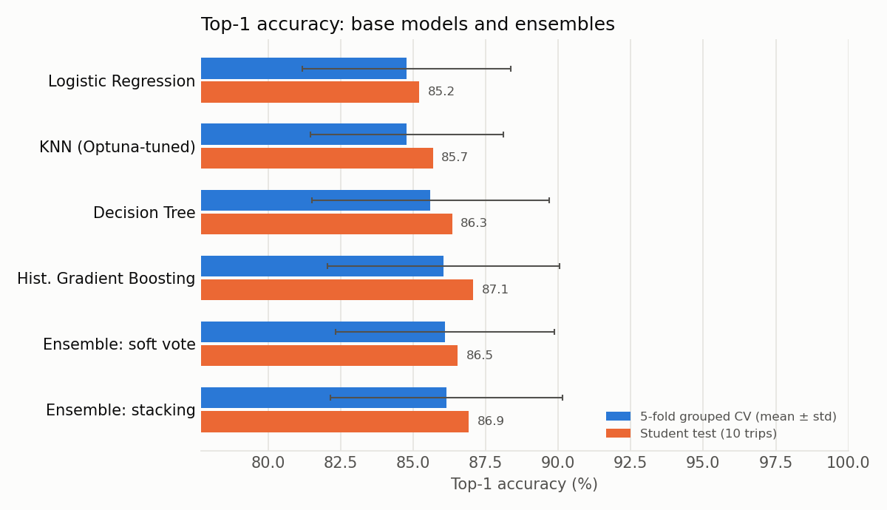

# All candidate models and the ensemble

## What was combined

Four candidate scorers already existed in the repository, each trained with its own pipeline. Logistic regression, the Decision Tree and Histogram Gradient Boosting used different feature sets from the KNN, so their numbers were not directly comparable. This section retrains all four on one shared dataset and builds two ensembles from them.

Every model reads the same 15 features from `pathsnap.features.candidate_features`: a 50 m candidate radius, up to 10 candidates per GPS reading, and labels from the monotone route alignment. Each model keeps the configuration its owner chose.

| Model | Configuration | Training rows |
| --- | --- | --- |
| Logistic Regression | StandardScaler, balanced class weights | every reading |
| KNN (Optuna-tuned) | k = 31, distance weights, Euclidean, feature-group multipliers from `results/knn_tuned/optuna_best.json` | every 5th reading |
| Decision Tree | max depth 12, at least 30 rows per leaf | every reading |
| Histogram Gradient Boosting | 150 iterations, learning rate 0.08, 31 leaves | every reading |

The KNN keeps the subsample its Optuna study selected, because it stores and scans its whole training set.

## Ensembles

- **Soft vote** averages the four probabilities with equal weight. It needs no fitting.
- **Stacking** fits a logistic regression on the logits of the four probabilities. It is trained only on out-of-fold probabilities, so it never sees a probability that a base model gave its own training rows.

The exported ensemble is the one with the higher mean cross-validation Top-1. Student-test results played no part in the choice. Stacking won, and it is saved as `results/ensemble/ensemble_model.joblib`. That file is about 65 MB because it contains the KNN training set, so it is git-ignored and must be rebuilt with the script.

The stacking meta-learner learned these weights on the logit scale:

| Base model | Weight |
| --- | ---: |
| Histogram Gradient Boosting | 0.633 |
| Decision Tree | 0.147 |
| KNN (Optuna-tuned) | 0.052 |
| Logistic Regression | 0.051 |
| Intercept | -0.053 |

## Protocol

- Cross-validation uses 5-fold GroupKFold by trip on the 80 training trips, with the same folds as the KNN study. Validation scores every 3rd GPS reading with all of its candidates.
- The stacking cross-validation score reuses the same trip folds over the out-of-fold table.
- Every model is then refit on all 80 training trips and scored once on the 10 student-test trips.
- Evaluator-testing trips are never read.
- Row-level metrics use a 0.5 threshold for every model. Top-1 and the route metrics do not depend on the threshold. Tuned KNN reports 0.425 in its own section, so its precision and recall differ slightly here.

## Results

| Model | CV Top-1 | Test Top-1 | Test macro F1 | Test log loss | Route F1 | Route mismatch | Continuity |
| --- | --- | ---: | ---: | ---: | ---: | ---: | ---: |
| Logistic Regression | 84.77 ± 3.58 % | 85.21 % | 0.826 | 0.235 | 0.903 | 0.217 | 0.780 |
| KNN (Optuna-tuned) | 84.78 ± 3.32 % | 85.67 % | 0.913 | 0.131 | 0.904 | 0.216 | 0.807 |
| Decision Tree | 85.59 ± 4.09 % | 86.34 % | 0.917 | 0.103 | 0.918 | 0.180 | 0.801 |
| Histogram Gradient Boosting | 86.04 ± 4.01 % | **87.07 %** | 0.921 | 0.096 | 0.915 | 0.187 | 0.822 |
| Ensemble: soft vote | 86.09 ± 3.78 % | 86.53 % | 0.920 | 0.114 | 0.916 | 0.185 | 0.818 |
| **Ensemble: stacking** | **86.15 ± 4.00 %** | 86.92 % | **0.921** | **0.094** | **0.921** | **0.174** | **0.825** |

Route metrics are length-weighted means over the 10 student-test trips. They take the classifier's best arc per reading, without the HMM, as defined in `scripts/knn/knn_sequence_metrics.py`. The candidate miss rate is 0.13 % for every model, because they all share one candidate set.



## Reading the results

- **Stacking gives the best cross-validation Top-1, but only by 0.11 points over boosting.** That is far smaller than the fold-to-fold spread of about 4 points, so the Top-1 gain is not meaningful.
- **On the student test, boosting alone is 0.15 points ahead of stacking on Top-1.** Stacking is still best on log loss, route F1, route mismatch and continuity.
- **The base models agree with each other on 92 to 94 % of readings.** They make many of the same mistakes, which caps what averaging can recover. Fold 3 is hardest for every model.
- **The meta-learner leans mostly on boosting.** Logistic regression and KNN add little once boosting and the tree are present.
- **The stacked ensemble is the candidate to pass to the HMM stage.** It gives the best-calibrated probabilities (lowest log loss), and Viterbi uses those probabilities directly as emissions. Boosting alone is the cheaper fallback. It is about 140 times faster at inference, because the ensemble has to run the KNN.


## Reproduce

```bash
export PATHSNAP_DATA_ROOT="/path/to/Student folder"   # contains train/ and student_test/
python scripts/ensemble/compare_all_models.py          # about 10 minutes; builds the feature cache if needed
python scripts/ensemble/plot_ensemble.py
```

Outputs go to `results/ensemble/`: the full metrics JSON, the comparison CSV, per-model student-test probabilities for the HMM stage, the plots, the run log and the exported ensemble. The reference run used Python 3.12 with scikit-learn 1.4.2 and NumPy 1.26.4.
