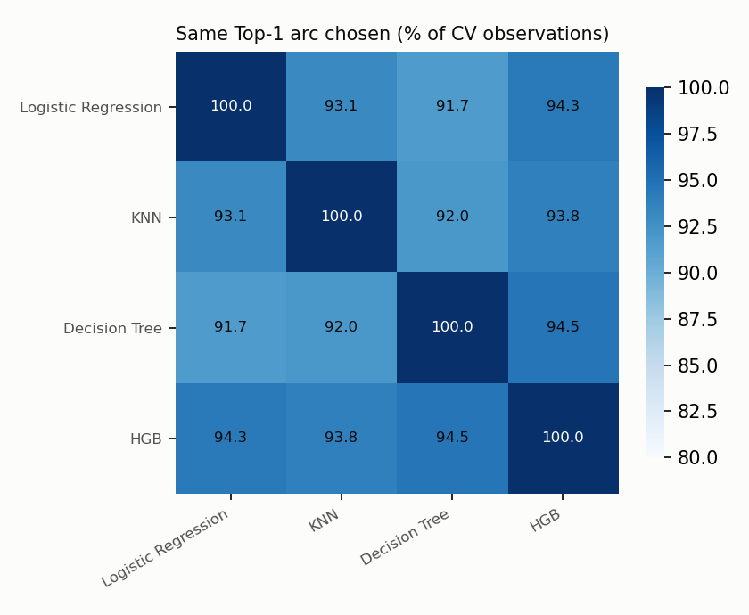

# All candidate models and the ensemble

## What was combined

Four candidate scorers already existed in the repository, each trained with its own pipeline. Logistic regression, the Decision Tree and Histogram Gradient Boosting used different feature sets from the KNN, so their numbers were not directly comparable. This section retrains all four on one shared dataset and builds two ensembles from them.

Every model reads the same 15 features from `pathsnap.features.candidate_features`: a 50 m candidate radius, up to 10 candidates per GPS reading, and labels from the monotone route alignment. Each model keeps the configuration its owner chose.

| Model | Configuration | Training rows |
| --- | --- | --- |
| Logistic Regression | StandardScaler, balanced class weights | every reading |
| KNN (Optuna-tuned) | k = 31, distance weights, Euclidean, feature-group multipliers from `results/knn_tuned/optuna_best.json` | every 5th reading |
| Decision Tree | max depth 12, at least 30 rows per leaf | every reading |
| Histogram Gradient Boosting | Optuna-tuned (`docs/report/hgb_tuning.md`): 250 iterations, learning rate 0.018, 106 leaves, depth 14, 159 rows per leaf, 41 % of features per split | every reading |

The KNN keeps the subsample its Optuna study selected, because it stores and scans its whole training set.

## Ensembles

- **Soft vote** averages the four probabilities with equal weight. It needs no fitting.
- **Stacking** fits a logistic regression on the logits of the four probabilities. It is trained only on out-of-fold probabilities, so it never sees a probability that a base model gave its own training rows.

The exported ensemble is the one with the higher mean cross-validation Top-1. Student-test results played no part in the choice. Stacking won, and its fitted base models and meta-learner are exported to the model bundle (`models/pathsnap_v1/`, see `scripts/export_model.py`).

The stacking meta-learner learned these weights on the logit scale:

| Base model | Weight with tuned boosting | Weight with untuned boosting (first run) |
| --- | ---: | ---: |
| Histogram Gradient Boosting | 0.973 | 0.633 |
| Decision Tree | 0.052 | 0.147 |
| KNN (Optuna-tuned) | 0.025 | 0.052 |
| Logistic Regression | -0.025 | 0.051 |
| Intercept | 0.081 | -0.053 |

Once boosting was tuned, the meta-learner put almost all its weight on it. The other three models add almost nothing that the tuned booster does not already capture.

## Protocol

- Cross-validation uses 5-fold GroupKFold by trip on the 80 training trips, with the same folds as the KNN study. Validation scores every 3rd GPS reading with all of its candidates.
- The stacking cross-validation score reuses the same trip folds over the out-of-fold table.
- Every model is then refit on all 80 training trips and scored once on the 10 student-test trips.
- Evaluator-testing trips are never read.
- Row-level metrics use a 0.5 threshold for every model. Top-1 and the route metrics do not depend on the threshold. Tuned KNN reports 0.425 in its own section, so its precision and recall differ slightly here.

## Results

| Model | CV Top-1 | Test Top-1 | Test macro F1 | Test log loss | Route F1 | Route mismatch | Continuity | Fit | Test scoring |
| --- | --- | ---: | ---: | ---: | ---: | ---: | ---: | ---: | ---: |
| Logistic Regression | 84.77 ± 3.58 % | 85.21 % | 0.826 | 0.235 | 0.903 | 0.217 | 0.780 | 3 s | 0.06 s |
| KNN (Optuna-tuned) | 84.78 ± 3.32 % | 85.67 % | 0.912 | 0.131 | 0.904 | 0.216 | 0.807 | 0.5 s | 51 s |
| Decision Tree | 85.59 ± 4.09 % | 86.34 % | 0.917 | 0.103 | 0.918 | 0.180 | 0.801 | 24 s | 0.03 s |
| Hist. Gradient Boosting (tuned) | 86.24 ± 3.97 % | **87.21 %** | **0.922** | 0.093 | **0.923** | **0.170** | 0.828 | 26 s | 0.7 s |
| Ensemble: soft vote | 86.10 ± 3.77 % | 86.46 % | 0.920 | 0.115 | 0.917 | 0.184 | 0.816 | 54 s | 52 s |
| **Ensemble: stacking** | **86.27 ± 4.00 %** | 87.18 % | **0.922** | **0.092** | 0.922 | **0.170** | **0.829** | 54 s | 52 s |

Route metrics are length-weighted means over the 10 student-test trips. They take the classifier's best arc per reading, without the HMM, as defined in `scripts/knn/knn_sequence_metrics.py`. The candidate miss rate is 0.13 % for every model, because they all share one candidate set. Timings are single local runs on a 12-core laptop.


## Reading the results

- **Stacking and tuned boosting are effectively the same model.** Stacking leads cross-validation Top-1 by 0.03 points and log loss by 0.001. Boosting leads student-test Top-1 by 0.03 points. All of these differences are far smaller than the 4-point spread between folds.
- **Stacking is exported because the selection rule, fixed before the test run, picks it.** It also has the lowest log loss, and the HMM uses the probabilities directly.
- **Tuned boosting alone is the practical fallback.** It gives the same accuracy and scores 10 trips in 0.7 s instead of 52 s, because it skips the KNN. The API lets the evaluator choose any model.
- **Averaging hurts.** The equal-weight soft vote is worse than boosting alone, because it gives the weaker logistic regression and KNN a quarter of the vote each.
- **The base models agree on 92 to 95 % of readings.** They make many of the same mistakes, which caps what any ensemble can recover. Fold 3 is the hardest for every model.



## Reproduce

```bash
export PATHSNAP_DATA_ROOT="/path/to/Student folder"   # contains train/ and student_test/
python scripts/ensemble/compare_all_models.py          # about 25 minutes; builds the feature cache if needed
python scripts/ensemble/plot_ensemble.py
```

Outputs go to `results/ensemble/`: the full metrics JSON, the comparison CSV, per-model student-test and out-of-fold training probabilities for the HMM stage, the plots, the run log and `trained_models.joblib` (git-ignored, about 65 MB; the compressed bundle in `models/pathsnap_v1/` holds the same models). The reference run used Python 3.12 with scikit-learn 1.4.2 and NumPy 1.26.4.
