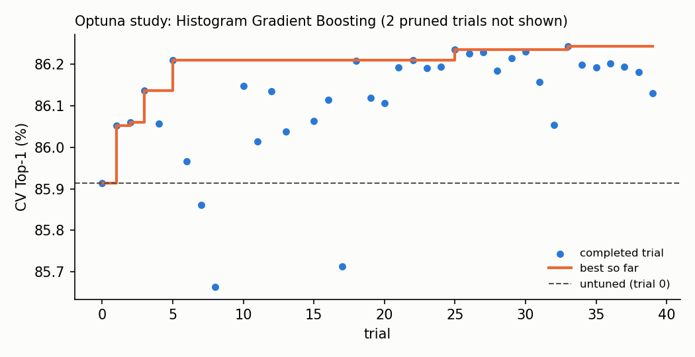

# Bayesian optimisation of Histogram Gradient Boosting

**Why this model.** In the shared comparison (`docs/report/ensemble.md`), Histogram Gradient Boosting had the best cross-validation and student-test Top-1 of the four base models. The stacking ensemble also gave it most of its weight. KNN had already been tuned (`docs/report/knn.md`), so boosting was the model worth tuning.

Scripts: `scripts/hgb/hgb_optuna.py` (study, refit and student test) and `scripts/hgb/plot_hgb_optuna.py` (plot). Results: `results/hgb_tuned/`.

## Study design

| Item | Setting |
| --- | --- |
| Sampler | Optuna TPE (Bayesian), seed 42 |
| Trials | 40, trial 0 = the untuned configuration |
| Pruner | Median pruner after the 2nd fold, from trial 5 (2 trials pruned) |
| Objective | Mean validation Top-1 over 5-fold GroupKFold by trip on the 80 training trips |
| Validation rows | Every 3rd GPS reading with all its candidates, the same folds and rows as the model comparison |
| Data never used | Student-test trips (read once after the study, for reporting) and evaluator trips |
| Cost | 185 minutes wall clock on a 12-core laptop, including time the machine was asleep |

Search space:

| Hyperparameter | Range | Untuned | Tuned |
| --- | --- | ---: | ---: |
| `learning_rate` | 0.01 – 0.3 (log) | 0.08 | 0.0181 |
| `max_iter` | 100 – 800 (step 50) | 150 | 250 |
| `max_leaf_nodes` | 8 – 255 (log) | 31 | 106 |
| `min_samples_leaf` | 10 – 1000 (log) | 20 | 159 |
| `l2_regularization` | 1e-4 – 10 (log) | 1e-4 (0 in the original) | 6.2e-4 |
| `max_features` | 0.4 – 1.0 | 1.0 | 0.41 |
| `max_depth` | none, or 3 – 16 | none | 14 |

Optuna's importance estimate ranks L2 regularisation (0.24), maximum depth (0.17), feature subsampling (0.15), learning rate (0.14) and leaf count (0.14) highest. The tuned model learns more slowly, grows larger but better-regularised trees and samples 41 % of the features at each split. That is a lower-variance ensemble of trees.

## Tuned versus untuned, same protocol

| | CV Top-1 | CV log loss | Test Top-1 | Test macro F1 | Test log loss | Route F1* | Route mismatch* | Fit time | Test scoring |
| --- | --- | ---: | ---: | ---: | ---: | ---: | ---: | ---: | ---: |
| Untuned | 85.91 ± 4.01 % | 0.112 | 87.04 % | 0.920 | 0.097 | 0.913 | 0.192 | 11 s | 0.34 s |
| **Tuned** | **86.24 ± 3.97 %** | **0.106** | **87.21 %** | **0.922** | **0.093** | **0.923** | **0.170** | 29 s | 0.68 s |

\* Classifier only, before the HMM: best candidate per reading, repeats collapsed, length-weighted, averaged over the 10 student-test trips.

## Interpretation

- **The gain is real in direction but small in size.** Cross-validation Top-1 rose 0.33 points, and student test followed with 0.17 points. Both are well inside the 4-point spread between folds, so the default configuration was already near what these features allow.
- **Probability quality improved more than ranking did.** Log loss fell about 5 % in cross-validation and 4 % on the student test. Route mismatch fell from 0.192 to 0.170. Better-calibrated probabilities matter for the HMM, which uses them directly as emissions.
- **The study converged.** The best-so-far curve is flat after trial 25, and the last 15 trials all lie within 0.1 points of the best. More trials would not change the conclusion.
- **The cost is acceptable.** Fitting takes 2.6 times longer and scoring 2 times longer, but scoring 10 trips still takes under a second.
- **No overfitting to the validation folds is visible.** The student-test gain has the same sign as the cross-validation gain, and those trips played no part in the search.

The tuned settings are written to `results/hgb_tuned/optuna_best.json`. `pathsnap.models.ensemble` reads them automatically, so the ensemble and the exported model bundle use the tuned booster.
